<p align="center">
  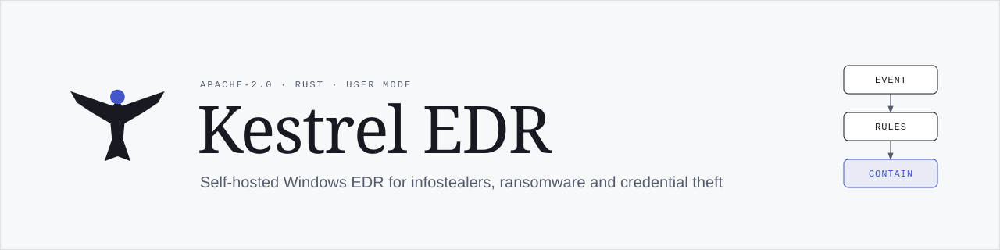
</p>

<p align="center">
  <a href="https://github.com/lawbyte/kestrel-edr/actions/workflows/ci.yml"></a>
  <a href="https://lawbyte.github.io/kestrel-edr/"></a>
  <a href="https://github.com/lawbyte/kestrel-edr/releases"></a>
  <a href="LICENSE"></a>
  
  
</p>

<p align="center">
  <a href="https://lawbyte.github.io/kestrel-edr/"><b>Documentation</b></a> &nbsp;&middot;&nbsp;
  <a href="https://lawbyte.github.io/kestrel-edr/guide/quick-start"><b>Quick start</b></a> &nbsp;&middot;&nbsp;
  <a href="https://lawbyte.github.io/kestrel-edr/build/"><b>Build from source</b></a> &nbsp;&middot;&nbsp;
  <a href="https://lawbyte.github.io/kestrel-edr/console/tour"><b>Console tour</b></a> &nbsp;&middot;&nbsp;
  <a href="#architecture"><b>Architecture</b></a> &nbsp;&middot;&nbsp;
  <a href="SECURITY.md"><b>Security</b></a>
</p>

Kestrel is a self-hosted endpoint detection and response (EDR) product for Windows, built to catch **infostealers** (Lumma, Vidar, StealC, Rhadamanthys and similar malware) while they work. These programs read browser passwords, cookies, crypto wallets and messenger sessions, then upload them. Kestrel watches for exactly that behaviour, contains the process, and gives IT one incident that says what was taken and what to rotate.

Since v1.1 it also covers the steps around a hands-on intrusion: **ransomware** preparation and encryption, **credential dumping** (LSASS, hives, NTDS) and **persistence** (Run keys, Startup, tasks, services, WMI, IFEO, Winlogon, COM), plus a curated **SigmaHQ** pack in Audit.

It has four parts:

* **Agent** (`kestrel-agent`): a Windows service written in Rust. It reads ETW sensors, runs the detection engine on the device, and contains threats.
* **Server** (`kestrel-server`): one Docker Compose stack per organisation, with PostgreSQL and optional ClickHouse. All telemetry stays on your own infrastructure.
* **Admin console**: a React app served by the server.
* **Tray app**: a small Tauri app for employees. It shows status, explains blocks in plain language and lets the employee request a review. An IT technician can turn protection off for a limited time from the tray with the device's uninstall token (detection only by default; every turn-off is a `TP-06` alert and an audit entry, and IT can turn it back on from the console).

> **Status: v1.1.4 (release candidate), user-mode only.** Validated on Windows 11 (26100) in a disposable lab VM. Read the limits section before you rely on it.

## Screenshots

Console screenshots use the built-in demo data (`npm run dev:mock`). The tray and remote-desktop images marked "real" come from a Windows 11 lab VM. Every console page, in light and dark, is in the [console tour](https://lawbyte.github.io/kestrel-edr/console/tour).

<table>
  <tr>
    <td width="50%">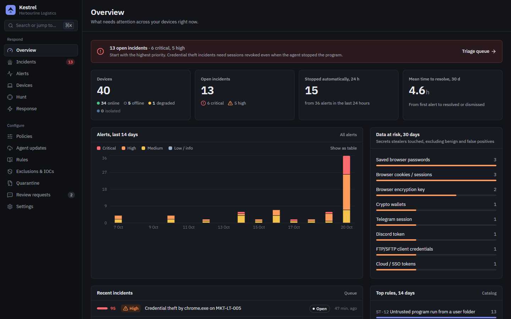<br><sub>Overview: open incidents, alerts by severity, data at risk</sub></td>
    <td width="50%">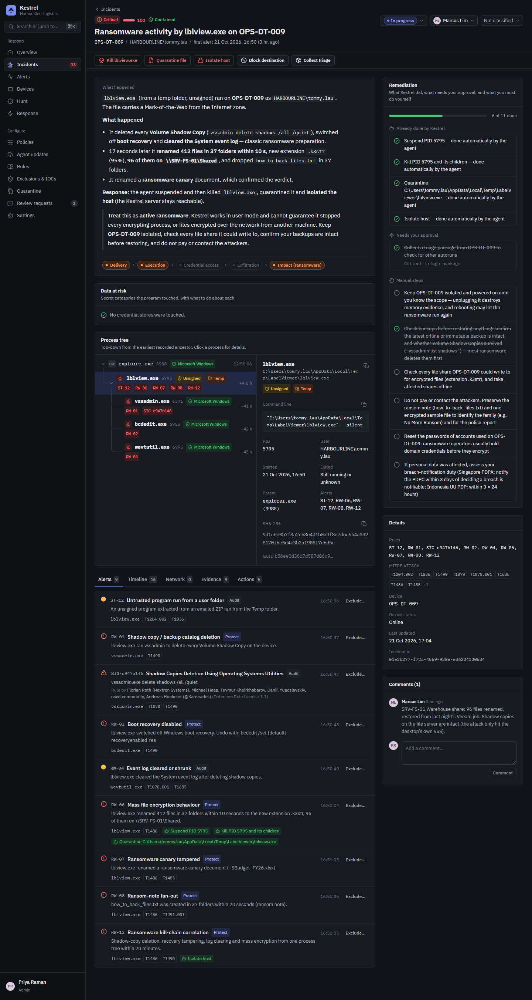<br><sub>Incident: storyline, process tree, remediation checklist</sub></td>
  </tr>
  <tr>
    <td>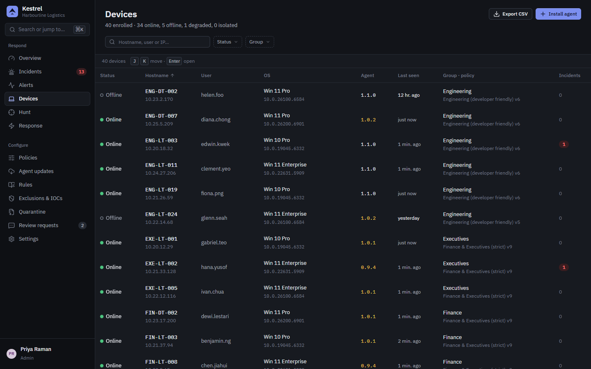<br><sub>Devices: health, policy, agent version</sub></td>
    <td>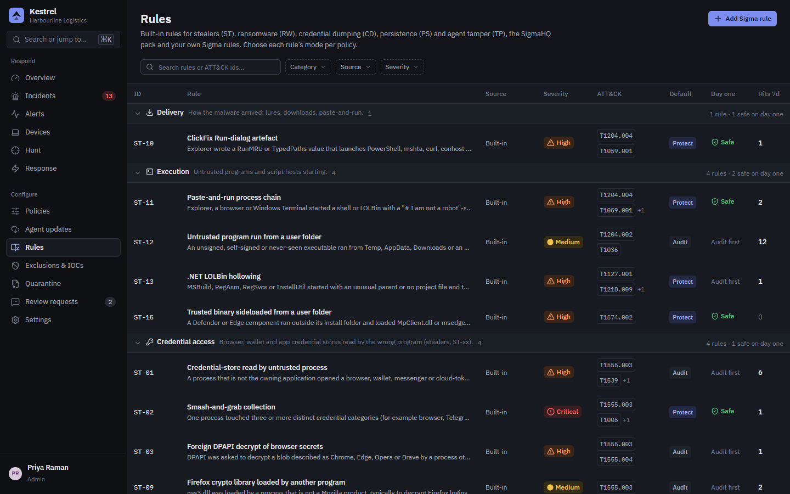<br><sub>Rules: built-in families and the SigmaHQ pack, Audit or Protect per policy</sub></td>
  </tr>
  <tr>
    <td>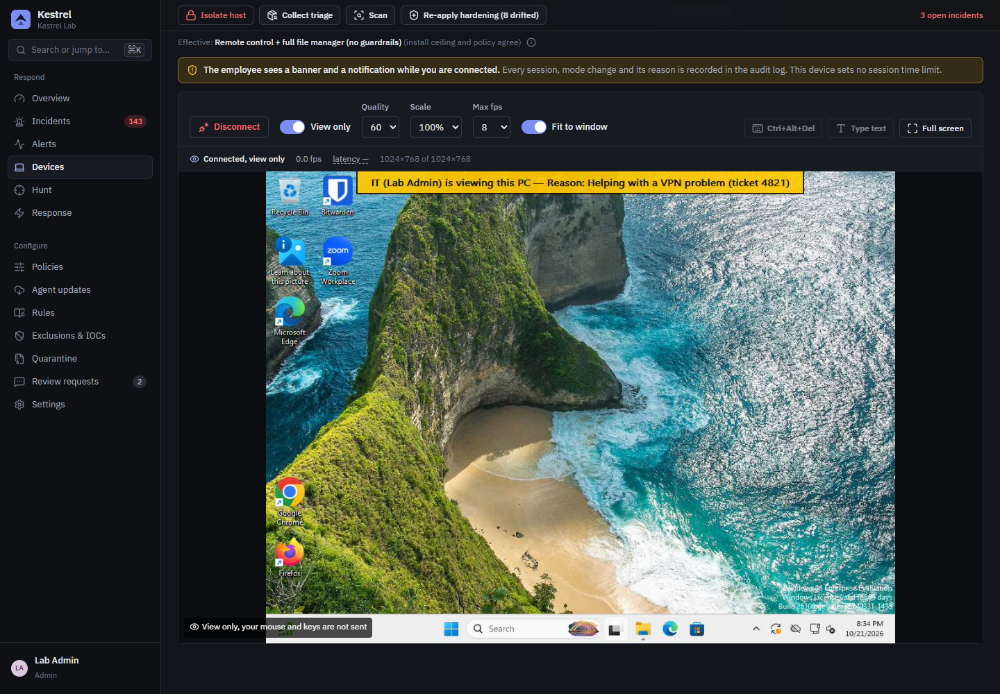<br><sub>Remote desktop of a real Windows 11 PC (lab VM), with the banner the employee sees</sub></td>
    <td>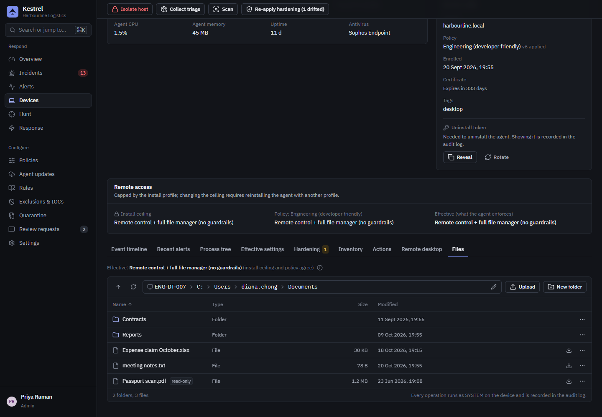<br><sub>Remote file manager</sub></td>
  </tr>
  <tr>
    <td>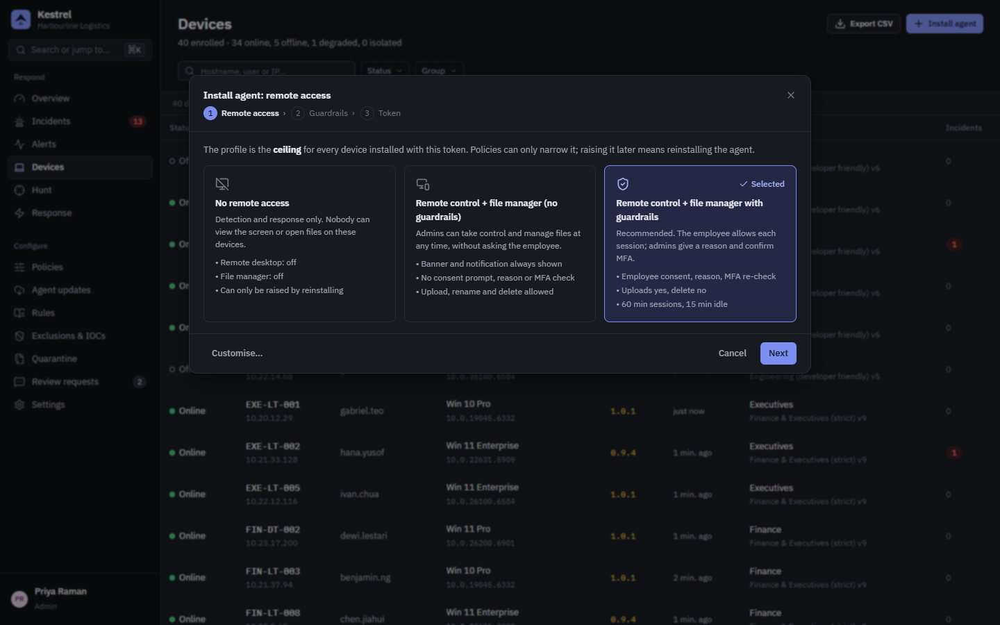<br><sub>Install wizard: choose the remote-access profile for new devices</sub></td>
    <td>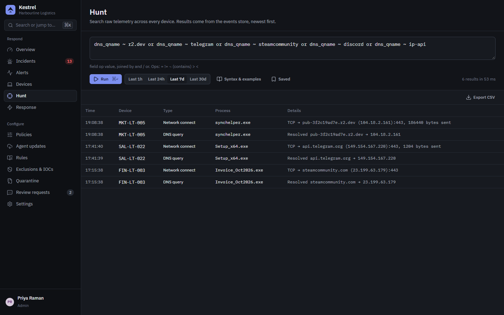<br><sub>Hunting over endpoint telemetry</sub></td>
  </tr>
  <tr>
    <td>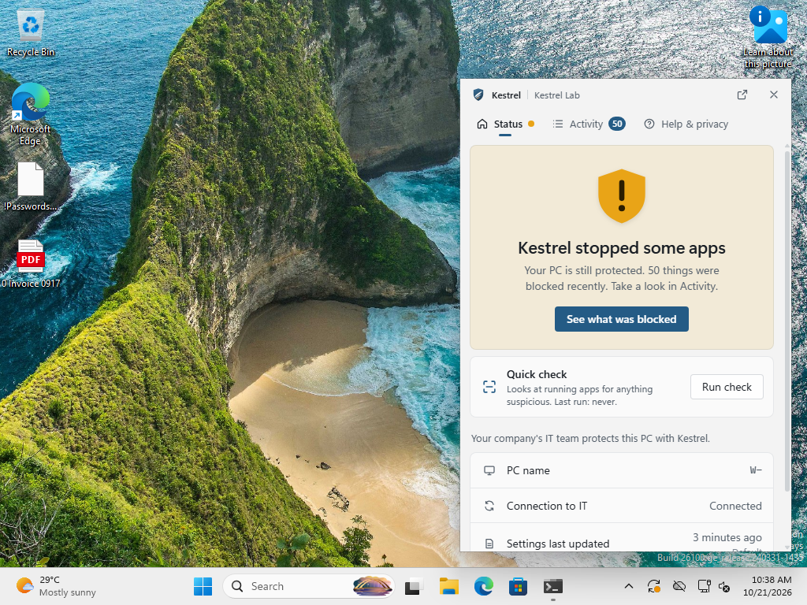<br><sub>Employee tray app on Windows 11 (real lab VM)</sub></td>
    <td>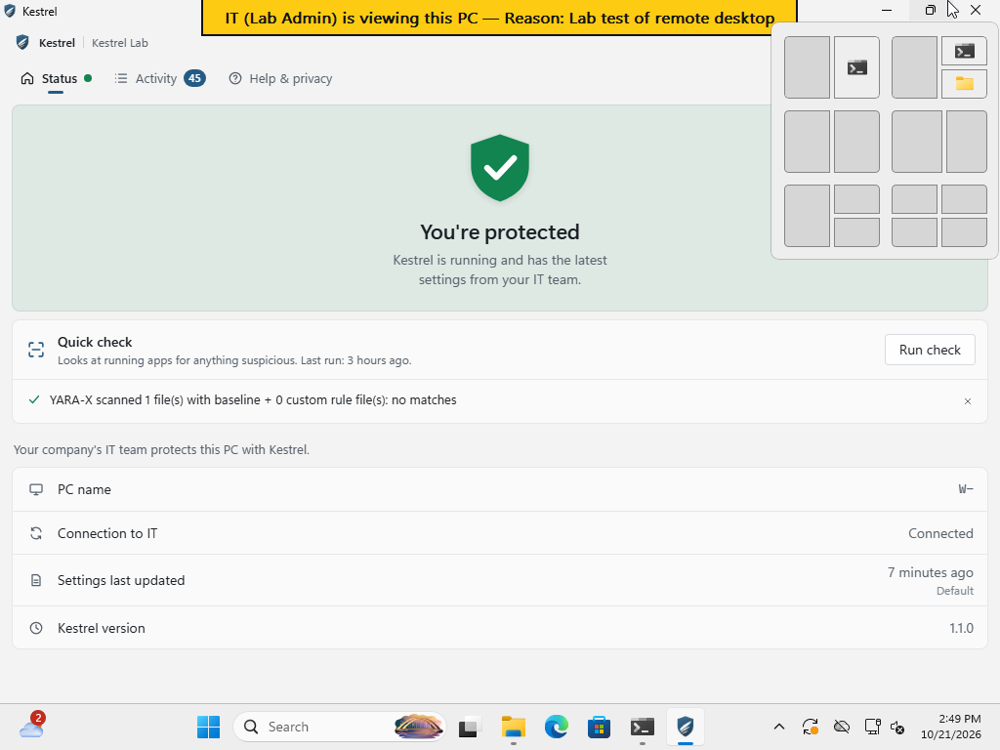<br><sub>The banner the employee sees during a remote session (real lab VM)</sub></td>
  </tr>
  <tr>
    <td>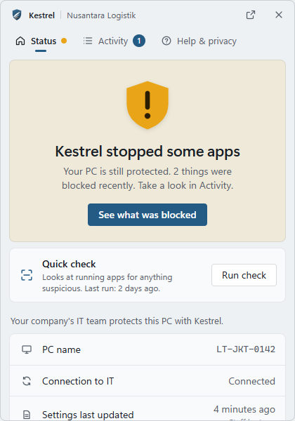<br><sub>Tray: what was stopped and why, with "Request review"</sub></td>
    <td>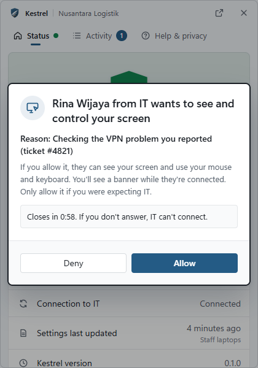<br><sub>Tray: consent prompt for a guarded remote session</sub></td>
  </tr>
</table>

## What it does

* **Detection on the device.** 55 built-in behavioural rules: stealer (`ST-01`…`ST-16`), ransomware (`RW-xx`), credential dumping (`CD-xx`), persistence (`PS-xx`) and tamper (`TP-01`…`TP-06`), plus 70 SigmaHQ rules in Audit. They run in the agent, so detection and containment still work while the device is offline.
* **Suspend on suspicion.** When an untrusted process opens a credential store or decrypts browser secrets with DPAPI, the agent freezes it for a short window (3 s by default). It kills the process if a stronger rule confirms the theft, and resumes it otherwise.
* **Response actions.** These can be automatic (rules in Protect mode) or issued by an analyst from the console:
  * kill or suspend/resume a process or process tree
  * quarantine a file into an encrypted vault, then restore or delete it
  * block a destination IP or an image's network access through WFP
  * isolate the host so that only the Kestrel server stays reachable (released automatically after `isolation_auto_release_hours` without server contact, default 72 h; local break-glass `kestrel-agent release-isolation --token …`)
  * scan with YARA-X
  * collect a triage package
  * re-apply hardening

  Actions issued while a device is offline are queued and delivered when it reconnects. They expire after 7 days.
* **Canary credential stores.** The agent plants decoy browser profiles of defunct Chromium forks that stealers enumerate (Kometa, 7Star: `Local State`, `Login Data`, a fake MetaMask vault) and decoy `.aws\credentials`. It never plants under a mainstream browser, so it does not make Chrome look installed to other browsers' import wizards. `ST-16` fires only when secret material in a decoy is read (not directory listings or incidental files such as profile pictures) by anything other than the agent or an allow-listed, validly signed security/search/backup tool. In Protect mode it kills the reader, blocks its network and quarantines it; the host is isolated only when the reader is unsigned and runs from a user-writable folder. A genuine browser or password manager installed under Program Files (valid signature by its vendor, no remote-debugging / headless / extension-loading switches, never injected into) may be importing data and gets an Audit alert only; per-user installs and every other reader get the full response. There is no general "never kill this app" list: false positives are fixed per rule.
* **Hardening pack.** A policy sets the pack's mode (Off, Audit or Enforce) and switches each control on or off:
  * AppLocker deny rules for `mshta` and for executables in Temp/Downloads
  * removing the Win+R Run dialog
  * the Windows Terminal multi-line paste warning
  * PowerShell script-block logging
  * the DPAPI debug channel
  * Defender ASR rules
  * Chrome/Edge `RemoteDebuggingAllowed=false`
* **Incidents, not alert floods.** The server groups alerts by device and process tree into incidents. Each incident gets:
  * a priority (0 to 100)
  * a plain-language storyline
  * the process tree and network evidence
  * the categories of data at risk
  * a checklist with three kinds of items: what the agent already did, one-click actions that need approval, and manual steps such as revoking sessions or moving wallet funds
* **Hunting.** A small filter language over telemetry, for example `event_type = dns_query and dns_qname ~ telegram`. Telemetry is stored in ClickHouse, or in Postgres for small sites.
* **Custom Sigma rules.** Rules are compiled and validated by the server, then pushed to agents and evaluated there with `rsigma`.
* **Operations features:**
  * RBAC with roles `admin`, `analyst` and `readonly`
  * OIDC SSO and TOTP MFA
  * API tokens for SIEM integrations
  * notifications by email, Slack, Teams, signed webhook and syslog (CEF/JSON)
  * a hash-chained audit log with a verify endpoint
  * live updates in the console through server-sent events (SSE)
  * signed agent updates (Ed25519)
* **Admin remote access: remote desktop and a remote file manager**, from the device page of the console.
  * **Remote desktop:** view-only or full control of the signed-in user's screen. It follows the UAC prompt and the lock screen where Windows allows, and has a Ctrl+Alt+Del button.
  * **File manager:** runs as SYSTEM. It can browse drives, download, upload, rename or move, delete and create folders. Kestrel's own folders and network paths are always refused.
  * **What each device allows is fixed when the agent is installed.** The console's *Install agent* wizard creates an enrollment token and a ready-to-run `Install-Kestrel-<profile>.cmd` with one of three remote-access profiles:
    * *No remote access* (the default);
    * *Remote control + file manager*;
    * *Remote control + file manager with guardrails*.
  * **The installed profile is a ceiling that the server can never raise.** The policy can only narrow it further.
  * **Guardrails** (all optional, chosen per profile):
    * the employee must click Allow in the tray;
    * the admin must give a reason;
    * MFA re-authentication before each session;
    * no upload and/or no delete;
    * session and idle limits;
    * allowed hours;
    * blocked folders.
  * **The employee always knows.** A banner stays at the top of their screen for the whole desktop session and the tray shows a notification, in every profile. There is no hidden mode.
  * **Admins only, interactive console session only** (API tokens are refused).
  * **Every session and file operation is in the hash-chained audit log,** with the SHA-256 of each transfer. Frames and file contents never reach telemetry, ClickHouse or logs.
* **Privacy controls for PDPA (Singapore) and UU PDP (Indonesia).**
  * Each upload category can be switched off separately: command lines, DNS, script content and raw telemetry.
  * User names can be replaced with salted hashes.
  * Path prefixes can be redacted.
  * Analysts' hunt queries are recorded in the audit log.
  * The tray app shows employees the organisation's monitoring notice.

## Honest limits (v1)

* **User mode only. There is no kernel driver.** Telemetry comes from ETW and the event log, so it arrives asynchronously, typically within about 1 s on the core session and up to about 5 s for file and network events. A fast stealer can read and send some data before the agent reacts. Kestrel aims to **detect fast and contain fast**, and it does not guarantee prevention. The incident checklist assumes the data may have left the device, and says so.
* An attacker with administrator or SYSTEM rights can blind ETW, stop sessions or remove WFP filters. The `TP-*` rules and the agent's watchdog detect and repair much of this, but a user-mode agent cannot fully defend itself against an admin.
* The Windows sensor layer has been validated on Windows 11 Enterprise 26100 in a disposable QEMU/KVM lab: install, all sensors, a benign emulation per rule, Protect actions, isolation and break-glass, upgrade and uninstall. It has not yet run on a fleet of physical machines or with Office/OneDrive-heavy workloads: see [docs/TESTING-ON-WINDOWS.md](docs/TESTING-ON-WINDOWS.md) and [docs/HANDOFF.md](docs/HANDOFF.md).
* Registry writes are attributed to a process by joining ETW with a registry watcher, because Windows 11 omits the key name in the ETW event. When more than one process could have written a value, Kestrel removes the autorun but does not act on any process, and the alert says the writer was inferred.
* Ransomware encrypting your files from **another** computer over SMB shows up as the System process: Kestrel alerts but cannot kill the remote encryptor.
* The binaries are not code-signed yet. Microsoft Defender currently flags the unsigned agent (a heuristic on its credential-store path tables); sign it before deployment (see [docs/BUILDING.md](docs/BUILDING.md)).
* Only Windows endpoints. The agent core and simulator also run on Linux and macOS for development, but there is no real sensor layer for them.
* Alert grouping and the hunt language are deliberately simple (see [docs/contracts.md](docs/contracts.md)).
* Remote desktop limits:
  * **Screen capture is GDI-based JPEG at 5 to 10 fps.** This is fine for support work but not for video, and a 4K screen at high quality costs bandwidth and CPU.
  * **No audio and no clipboard sync**; the console can type text instead.
  * **The mouse pointer is not drawn** into frames.
  * **UAC prompts and the lock screen** are captured and controllable because the helper runs as SYSTEM, but the on-screen banner cannot appear on that secure desktop; the tray notification still does.
  * **Ctrl+Alt+Del only works** when the Windows policy `SoftwareSASGeneration` allows services to send it.
  * **Multiple monitors** are shown as one virtual screen.
  * **No one signed in:** a desktop session needs a user at the console. With consent required, no answer counts as Deny.
  * **Lab validation pending:** the remote desktop has only been unit-tested on Windows so far; checklist in [docs/HANDOFF.md](docs/HANDOFF.md).
* **A compromised admin account or server can use remote access on every device whose install profile allows it.** Enable MFA for every admin, consider the guarded profile, and restrict network access to the console.

## Detection rules

| Id | Rule | Default |
|---|---|---|
| ST-01 | Credential-store read by untrusted process | Audit |
| ST-02 | Smash-and-grab credential collection (≥ 3 secret categories in 60 s) | **Protect** |
| ST-03 | Foreign DPAPI unprotect of browser secrets | Audit |
| ST-04 | Steal-then-send (credential read, then external connection within 300 s) | **Protect** |
| ST-05 | Browser debugging abuse (`--remote-debugging-*` with headless/alt profile) | Audit |
| ST-06 | Local CDP client (non-browser connects to the DevTools port) | Audit |
| ST-07 | Browser process tampering (memory access, injection, debugger attach) | **Protect** |
| ST-08 | Chrome elevation-service abuse | Audit |
| ST-09 | Foreign crypto library load (`nss3.dll`) | Audit |
| ST-10 | ClickFix Run/Address-bar artefact (RunMRU / TypedPaths) | Audit |
| ST-11 | Paste-and-run process chain | Audit |
| ST-12 | Untrusted execution from user paths | Audit |
| ST-13 | .NET LOLBin hollowing | Audit |
| ST-14 | Dead-drop / exfil service from non-browser (Telegram, Steam, Discord webhooks, …) | Audit |
| ST-15 | Trusted-binary sideload from user path | Audit |
| ST-16 | Canary tripwire | **Protect** |
| TP-01 | Telemetry session tampering | Audit |
| TP-02 | WFP filter tampering | Audit |
| TP-03 | AMSI tampering | Audit |
| TP-04 | Agent service or file tampering | Audit |
| TP-05 | Telemetry loss | Audit |
| TP-06 | Protection turned off on the device (tray switch, uninstall token) | Audit (never acts) |

Ransomware, credential dumping and persistence (v1.1):

| Id | Rule | Default |
|---|---|---|
| RW-01 | Shadow copy / backup catalog deletion | **Protect** |
| RW-02 | Boot recovery disabled | **Protect** |
| RW-03 | Safe-mode boot staging | **Protect** |
| RW-04 | Event log cleared or shrunk | Audit |
| RW-05 | Service / process kill spree | **Protect** |
| RW-06 | Mass file encryption behaviour | **Protect** |
| RW-07 | Ransomware canary tampered | **Protect** |
| RW-08 | Ransom-note fan-out | **Protect** |
| RW-12 | Ransomware kill-chain correlation | **Protect** |
| CD-01 | LSASS memory dump via comsvcs MiniDump | **Protect** |
| CD-02 | Known LSASS dumping tool | **Protect** |
| CD-03 | Suspicious LSASS handle request | Audit |
| CD-04 | LSASS handle followed by a dump file | **Protect** |
| CD-05 | Debug library dump helper reading LSASS | **Protect** |
| CD-06 | Blocked LSASS access attempt | Audit |
| CD-07 | LSASS dump preparation via SilentProcessExit / IFEO | **Protect** |
| CD-08 | LSASS dump via Windows Error Reporting | **Protect** |
| CD-09 | Malicious LSA security package | Audit |
| CD-10 | Credential hive save or copy | **Protect** |
| CD-11 | NTDS.dit extraction | Audit |
| CD-12 | WDigest cleartext credential downgrade | **Protect** |
| CD-13 | LSA protection / Credential Guard tamper | Audit |
| PS-01 | Run key to untrusted payload | Audit |
| PS-02 | Autorun via script host or LOLBin | **Protect** |
| PS-03 | Startup-folder drop | **Protect** |
| PS-04 | Startup folder redirection | Audit |
| PS-05 | Scheduled task with untrusted action | Audit |
| PS-07 | Suspicious service install | **Protect** |
| PS-08 | WMI permanent event subscription | **Protect** |
| PS-09 | IFEO / SilentProcessExit hijack | **Protect** |
| PS-10 | Winlogon / AppInit / AppCert / BootExecute change | **Protect** |
| PS-11 | COM hijack in user hive | Audit |
| PS-15 | Persistence rollback | **Protect** |

Persistence rules in Protect remove the autorun, after backing up the original in the quarantine vault. They act on the writing process only when Kestrel knows exactly which process wrote it. The 70-rule **SigmaHQ pack** (`SIG-<uuid8>`) is seeded in Audit; the console shows each rule's authors and the DRL 1.1 licence.

The **Protect** rules are the "safe on day one" set. Run everything else in Audit for about two weeks first. The console's Rules page shows each rule's logic, its ATT&CK mapping, its Protect action and known false positives.

## Architecture

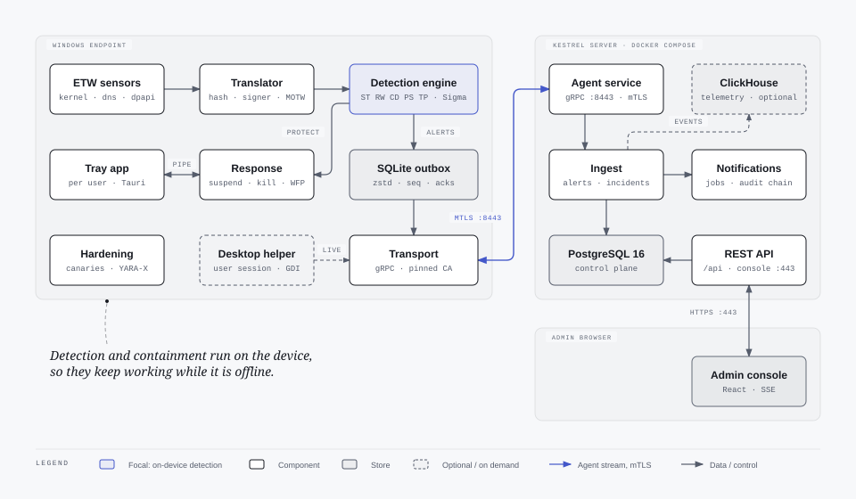

More diagrams: [detection flow](docs/diagrams/detection-flow.svg), [remote-access ceiling](docs/diagrams/enrollment.svg) and [deployment](docs/diagrams/deployment.svg) (HTML sources next to them in `docs/diagrams/`).

For data flow, the detection pipeline and the security model, see [docs/ARCHITECTURE.md](docs/ARCHITECTURE.md).

## Quick start

The illustrated, step-by-step version of this section, with a screenshot for every step, is the **[Step-by-step install guide](https://lawbyte.github.io/kestrel-edr/guide/quick-start)**.

### 1. Start the server (Docker Compose)

```bash
git clone https://github.com/lawbyte/kestrel-edr.git
cd kestrel-edr/deploy
cp .env.example .env
nano .env                       # set the four values below
mkdir -p installers && cp /path/to/KestrelAgent.msi installers/
docker compose up -d --build
docker compose logs kestrel-server | grep "SETUP CODE"
```

| `.env` setting | Value |
|---|---|
| `KESTREL_MASTER_KEY` | `openssl rand -base64 32`. Keep a copy outside the server. |
| `KESTREL_PUBLIC_HOSTNAME` | The name or IP your PCs use to reach the server. The first one in the list goes into the installers. |
| `POSTGRES_PASSWORD`, `CLICKHOUSE_PASSWORD` | Long random values. |

`KestrelAgent.msi` comes from the `kestrel-windows` artifact of the latest green [CI run](https://github.com/lawbyte/kestrel-edr/actions/workflows/ci.yml), or from [building it yourself](https://lawbyte.github.io/kestrel-edr/build/). PCs reach the server on TCP 443 (console, installer download) and 8443 (agents).

### 2. Set up the console

Open `https://<your server>/`, accept the self-signed certificate warning, and enter the setup code, your organisation name and the first administrator account.

### 3. Install the agent on a PC

1. In the console: **Devices**, then **Install agent**. Choose the remote-access profile, then the group and how long the installer stays valid. Download `Install-Kestrel-<profile>.cmd`.
2. On the PC (until the binaries are code-signed), add a Defender exclusion in an administrator PowerShell: `Add-MpPreference -ExclusionPath 'C:\Program Files\Kestrel'`.
3. Double-click the `.cmd` and approve the administrator prompt, or deploy it with Group Policy, Intune or an RMM as `Install-Kestrel-<profile>.cmd /quiet`.
4. The PC appears under **Devices** within seconds. The employee sees the Kestrel tray icon at the next sign-in.

Uninstalling needs the device's uninstall token (device page, **Uninstall token**, **Reveal**; the reveal is audit-logged): `msiexec /x <product code> /qn UNINSTALL_TOKEN=<token>`. See [Enroll devices](https://lawbyte.github.io/kestrel-edr/deploy/enroll) for mass deployment, upgrades and uninstall, and [Deploy the server](https://lawbyte.github.io/kestrel-edr/deploy/server) for TLS, backups, upgrades and sizing.

## Development workflow

To try everything on Linux without Windows, run the end-to-end test:

```bash
# Linux: build, then run the full end-to-end test (server + 3 simulated endpoints)
./scripts/e2e.sh                         # starts a throwaway Postgres if DATABASE_URL is unset
E2E_KEEP=1 ./scripts/e2e.sh              # ...and leave the server up at https://127.0.0.1:18443
```

It replays recorded attacks (`crates/kestrel-agent/replays/*.jsonl`) through the real agent core and the real server. It then checks the incidents, data at risk, response-action delivery, the audit chain and hunting.

To work on the console, the tray and Windows builds:

* Console, mock data: `cd console && npm run dev:mock`
* Console, against a server: `npm run dev`. It proxies `/api`.
* Tray UI, mock data: `cd tray && npm run dev:mock`
* Windows cross-check from Linux: `cargo wincheck -p kestrel-agent` (see [docs/BUILDING.md](docs/BUILDING.md))
* On a Windows host: `scripts/windows-smoke.ps1` checks that the ETW sensors produce events
* Disposable Windows lab: `scripts/vm/` builds a QEMU/KVM Windows 11 guest inside WSL2 and runs the benign emulations (`scripts/vm/emulate.ps1`); see [docs/TESTING-ON-WINDOWS.md](docs/TESTING-ON-WINDOWS.md). Never run the agent's response actions on your own PC.

`.github/workflows/ci.yml` defines these checks:
* `cargo fmt --check`, `clippy -D warnings` and `cargo test --workspace`
* the console and tray builds and tests
* `scripts/e2e.sh` and the server image
* the Windows agent, scanner, tray and MSI builds, and the ETW smoke test on a Windows runner
* the licence policy (`cargo deny`, no copyleft)
* optional Azure Artifact Signing

The workflow has not run on GitHub yet because no remote is configured. The same checks were run locally for v1.1.0-rc1 (see [docs/HANDOFF.md](docs/HANDOFF.md)).

## Repository layout

```
crates/
  kestrel-common     shared types: events, alerts, policy, response actions, wire + tray protocols
  kestrel-detect     detection engine: rules ST/RW/CD/PS/TP, process table, IOCs, exclusions, Sigma, canaries
  kestrel-platform   Platform trait (sensors, response, hardening, canaries, tray) the agent runs on
  kestrel-win        Windows implementation: ETW, enrichment, WFP, quarantine vault, AppLocker, service, tray pipe
  kestrel-agent      agent binary: enrollment, mTLS transport, SQLite outbox, engine loop, privacy filter,
                     simulator (SimPlatform) + replays/, signed updates
  kestrel-scan       on-demand YARA-X scanner (separate process, kept out of the always-running agent)
  kestrel-msica      MSI custom actions (tokens go to the agent on stdin, never on a command line)
  kestrel-server     axum REST + tonic gRPC, internal CA, Postgres/ClickHouse, incidents, RBAC, audit, notifications, agent updates
console/             React admin console (Vite); `npm run build` → console/dist (served by the server)
tray/                Tauri 2 employee tray app (own Cargo workspace in tray/src-tauri)
proto/               kestrel.proto (agent ↔ server gRPC)
deploy/              Dockerfile, docker-compose.yml, .env.example, operations README
installer/           Kestrel.wxs (WiX v6 MSI)
scripts/             e2e.sh (Linux end-to-end), windows-smoke.ps1 (Windows ETW smoke test), vm/ (disposable Windows lab)
docs/                contracts.md, ARCHITECTURE.md, BUILDING.md, TESTING-ON-WINDOWS.md, HANDOFF.md, DECISIONS.md, research/, screenshots/
```

## Known gaps

* Server-side detections only cover agent health and identity: `TP-SRV-HEARTBEAT` (missed heartbeats), `TP-SRV-SEQ-RESET` (outbox sequence reset), `TP-SRV-OUTBOX-RESET` (outbox database recreated), `TP-SRV-EVENTS-LOST`, `TP-SRV-ETW` and `TP-SRV-DUP-ENROLL` (hardware UUID reused by a new enrollment). Cross-device correlation is not implemented.
* Agent updates are pushed by ring (canary, early, broad) from the console's Agent updates page. Releases must be signed with the owner's offline Ed25519 key (`kestrel-agent update-keygen` / `update-sign`); none is configured out of the box.
* The open items of the security review are listed below.
* For anything beyond about 5,000 endpoints, add a message bus and multiple ingest replicas (see deploy/README sizing).

## Security review status

**v1.1 review.** A second independent review of the v1.1 code ([docs/security-review-v1.1-2026-10-21.md](docs/security-review-v1.1-2026-10-21.md)) found 0 critical, 10 high, 12 medium and 18 low issues. They included:
* a server ingest stall that a NUL character could trigger;
* ways to frame a legitimate process as a registry writer.

Two fix rounds followed, and a fresh re-review confirmed the fixes. The residual risks are listed in [docs/HANDOFF.md](docs/HANDOFF.md).

**v1.0 review.** An independent review on 2026-10-21 ([docs/security-review-2026-10-21.md](docs/security-review-2026-10-21.md)) found 0 critical, 10 high, 12 medium and 12 low issues. Unit and integration tests and `scripts/e2e.sh` cover the fixes. The Windows-only parts were also run in the lab VM.

| Finding | Status | Notes |
|---|---|---|
| H1 Process made unkillable by name or path | Fixed | One shared protected list: exact path on the system volume + valid Microsoft signature; `PathClass` is volume-aware |
| H2 Identity takeover via `hw_uuid` | Fixed | Enrollment always creates a new device; duplicates flagged (`TP-SRV-DUP-ENROLL`) and merged / dismissed by an admin |
| H3 Certificates never renewed | Fixed | Renewal over the mTLS stream with atomic swap and rollback; the server asks when < 30 days remain |
| H4 Pre-created state directory | Fixed | Owner and DACL verified at install, enroll and every start; untrusted directories moved aside |
| H5 OIDC login by email match | Fixed | Bound by `(issuer, sub)` only, `email_verified` required, admins link accounts explicitly |
| H6 Empty OIDC domain list fail-open | Fixed | Empty list denies; default role can never be an admin role |
| H7 First run unhashed / unsigned | Fixed | First-run images held ≤ 750 ms for hash + signature; late facts re-run IOCs and rules; `Unknown` never trusted |
| H8 Quarantine / restore follow junctions | Fixed | No reparse points or extra hard links, final-path check, hash before ACL changes, handle-relative restore |
| H9 AppLocker allow-all over GPO policy | Fixed | Effective policy inspected; GPO/MDM-managed policies never touched |
| H10 Isolation can strand a host | Fixed | Permits re-planned every minute, server permit agent-only, auto-release (`isolation_auto_release_hours`) and `release-isolation` break-glass (lab-verified). While isolated, DNS is allowed only for the agent (image + service SID) |
| M1 Exclusions ignore the drive / `*` spans folders | Fixed | Drive kept; `*` within a segment, `**` across |
| M2 Review approval creates path exclusions | Fixed | sha256 or valid-signer exclusions only, for the alerted rule, 90-day expiry |
| M3 Tray pipe abuse | Fixed | Requests attributed to the pipe client's token; per-user activity; rate limits |
| M4 Login lockout / spoofable IP key | Fixed | Backoff counted on failures only; `X-Forwarded-For` only from `KESTREL_TRUSTED_PROXIES` |
| M5 Uninstall token never escrowed | Fixed | Server-issued at enrollment, audited reveal, rotation over the wire (`SetUninstallToken`), hidden from MSI logs |
| M6 Enrollment tokens leak via command lines | Fixed (residual) | The MSI custom action (`kestrel-msica`) passes tokens to the agent on stdin, and none appear in the verbose MSI log (lab-verified). Local process monitors can still see the admin's own `msiexec … TOKEN=` command line |
| M7 Future heartbeat disables processing | Fixed | Dedup by seq, timestamps clamped to server time |
| M8 Outbox reset discards messages | Fixed | `Hello.outbox_epoch`; a new epoch resets the high-water mark and raises `TP-SRV-OUTBOX-RESET` |
| M9 Incomplete privacy minimisation | Fixed | Health, review and alert users hashed; alert process, ancestry and summaries scrubbed like events |
| M10 Permanent host-wide IOC blocks, any CIDR | Fixed | Wide / private ranges need confirmation, ≤ /8 refused; blocks per offending image with a TTL (`ioc_block_ttl_secs`); deleting an IOC lifts the blocks it caused |
| M11 ST-16 auto-isolates on any reader | Fixed | Signed backup / AV / indexer readers ignored; isolation only for unsigned readers in user-writable paths |
| M12 No revocation checks | Fixed | Revocation checked in the background (cache, then online); revoked signers become `Invalid` |
| L1 TOTP replay, password oracle | Fixed | |
| L2 API tokens on `/me`, no expiry | Fixed | |
| L3 Unauthenticated first-run setup | Fixed | One-time setup code (`KESTREL_SETUP_CODE` or server log) |
| L4 OIDC start amplifier | Fixed | |
| L5 Sessions and SSE not cut off | Fixed | |
| L6 Audit chain rewritable | Fixed | HMAC chain keyed from the master key, head anchored to log / syslog |
| L7 Notification SSRF / injection / exposure | Fixed | |
| L8 Review requests for other devices' alerts | Fixed | |
| L9 ST-11 kills the parent shell | Fixed | |
| L10 Exclusions without guardrails, silence TP rules | Fixed | |
| L11 Different kill-safety lists | Fixed | |
| L12 Canary planting follows junctions | Fixed | |
| Info: update manifest signs only the hash | Fixed | Signature over `kestrel-update-v1\n{version}\n{url}\n{sha256}` |
| Info: monotonic `policy.version` after a DB restore | Fixed | The server raises its policy versions to the highest version agents report (bounded) and raises `TP-SRV-VERSION` |

## Licence

Apache-2.0. See `Cargo.toml` (`license = "Apache-2.0"`). The dependency licence policy is in `deny.toml`. GPL, AGPL, SSPL and ELv2 dependencies are rejected.

## Credits

* Rule logic draws on public research by SigmaHQ, Elastic Security Labs, Google (Chrome DPAPI event-log detection), Microsoft Threat Intelligence (ClickFix, Lumma), SpecterOps, Unit 42, Kaspersky and Intrinsec. Each rule's references are listed in `crates/kestrel-detect/src/catalog.rs` and on the console's Rules page.
* **SigmaHQ rules are licensed under the [Detection Rule License (DRL) 1.1](https://github.com/SigmaHQ/Detection-Rule-License).** Kestrel's built-in rules are original Rust implementations. If you import SigmaHQ rules as custom Sigma rules, the DRL requires you to keep the author attribution. Kestrel keeps the rule's `author` as `rule_author` on every alert and shows it in the console. The server recognises DRL/SigmaHQ rules by their `license` and `references` fields.
* Kestrel ships a curated pack of 70 SigmaHQ rules from a pinned upstream commit, Audit by default, under the DRL 1.1; the console shows each rule's authors, licence and upstream link. Sigma evaluation uses `rsigma-parser`/`rsigma-eval` (MIT). ETW uses `ferrisetw`. On-demand scanning uses YARA-X (BSD-3-Clause).
* Remote-desktop frames are encoded with `jpeg-encoder` (MIT OR Apache-2.0). This software is based in part on the work of the Independent JPEG Group.
* Diagrams drawn with the [diagram-design](https://github.com/cathrynlavery/diagram-design) skill by Cathryn Lavery (MIT licence), skinned with the Kestrel console palette.
